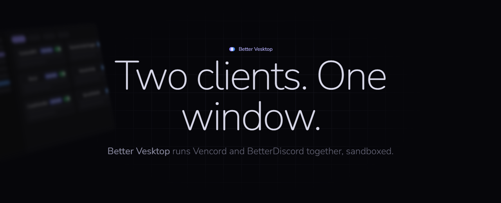

<p align="center">
  
</p>

<p align="center">
  <a href="README.md">English</a> · <b>Русский</b> · <a href="https://kolyagames.github.io/better_vesktop/">Сайт</a>
</p>

# Better Vesktop

[Vesktop](https://github.com/Vencord/Vesktop) со встроенным [BetterDiscord](https://betterdiscord.app). Плагины Vencord и BetterDiscord работают в одном клиенте, в одном меню настроек, а окно Discord остаётся в песочнице.

> Неофициальный проект. Не связан с Discord, Vencord, Vesktop и BetterDiscord.

## Что внутри

- **Один раздел настроек.** Vencord и BetterDiscord слиты в общий раздел «Better Vesktop», а не лежат двумя отдельными.
- **Один список плагинов.** На странице Plugins плагины обоих клиентов лежат рядом: поиск, фильтры (Все, Vencord, BetterDiscord, Включённые, Выключенные), переключатели и настройки каждого плагина. Каталог BetterDiscord открывается одной кнопкой.
- **Песочница сохранена.** Обычному BetterDiscord нужен Node.js внутри окна Discord. Better Vesktop оставляет окно в песочнице, как Vesktop, а BetterDiscord получает узкий мост, см. [Безопасность](#безопасность).
- **Портативность.** Настройки, сессия, плагины и темы лежат в двух папках рядом с приложением. Реестр не меняется, остальной компьютер не затрагивается.

## Установка

1. Скачай последний `.zip` на [странице релизов](https://github.com/kolyagames/better_vesktop/releases/latest).
2. Распакуй папку куда угодно, кроме `Program Files`, и запусти `better-vesktop.exe`.
3. SmartScreen может предупредить, потому что сборка не подписана: нажми **Подробнее**, затем **Выполнить в любом случае**.
4. Войди в Discord.

Чтобы удалить всё, удали папку. Если ты уже пользуешься BetterDiscord, скопируй плагины и темы в папку `BetterDiscord` рядом с приложением.

В релизе есть и установщик (`.exe`): он сам обновляет приложение.

## Безопасность

Страница Discord и все плагины работают в песочнице без Node.js. С компьютером BetterDiscord общается только через мост в основном процессе (`src/main/betterdiscord`), и этот мост решает, что можно:

| Плагины могут | Плагины не могут |
| --- | --- |
| читать и писать внутри папки BetterDiscord | трогать любые другие файлы и папки |
| открывать файлы, которые ты выбрал сам в диалоге | обращаться к `localhost` и устройствам в твоей сети |
| загружать сайты и API из интернета | запускать программы и открывать исполняемые файлы |
| открывать ссылки `http(s)` и `mailto` | писать в вебхуки Discord, использовать `file://` и слать произвольные IPC-команды |

Плагин всё равно остаётся кодом внутри страницы Discord, поэтому видит и может менять то, что показывает страница. Ставь плагины из каталога BetterDiscord или от авторов, которым доверяешь.

Ограничения можно ослабить в `Data/settings.json`:

```json
{
    "betterDiscord": {
        "enabled": true,
        "allowLocalNetwork": false,
        "extraPaths": ["D:/Music"]
    }
}
```

Запуск с флагом `--vanilla` включает приложение без BetterDiscord на один раз. Подробности и как сообщить о проблеме: [SECURITY.md](SECURITY.md).

## Совместимость

- Большинство плагинов BetterDiscord работает. Плагины, которым нужны родные функции десктопного Discord (`DiscordNative`), в Vesktop работать не могут, а плагины, читающие файлы вне разрешённых папок, блокирует песочница.
- Плагины Vencord работают как во Vesktop.
- Релизы собираются и проверяются на Windows 10 и 11 (x64). На других платформах проект собирается из исходников, но не проверен.

## Сборка из исходников

Нужны Node.js 22+ и pnpm 11+.

```sh
pnpm install
pnpm build            # production-сборка в dist/
pnpm start            # собрать и запустить
pnpm package          # установщик и zip через electron-builder
```

Во время разработки удобно `pnpm start:dev`. Переменная `BETTER_VESKTOP_BD_DIR` направляет BetterDiscord в другую папку, это удобно для тестов.

Как всё устроено:

| Часть | Где |
| --- | --- |
| Релиз BetterDiscord, закреплённый и с проверкой хэша | `vendor/betterdiscord` |
| Патчи его renderer при сборке | `scripts/build/betterdiscord.mts` |
| Preload-мост в песочнице | `src/preload/betterdiscord.ts` |
| Основной процесс: пути, сеть, окна, редактор | `src/main/betterdiscord` |
| Общие настройки и единая страница плагинов | `src/renderer/betterVesktop` |

## Android

Android-версия — то же самое на телефоне: веб-клиент Discord с discord.com, в который загружены Vencord и BetterDiscord. Ставится как Aliucord: отдельная иконка **BV Manager** пошагово устанавливает компоненты и держит их свежими.

- **Discord** всегда последней версии: это веб-клиент, который отдаёт сам Discord.
- **Vencord** — последний релиз его веб-сборки, менеджер скачивает его сам.
- **BetterDiscord** — последний релиз, пропатченный прямо на телефоне теми же патчами, что и в десктопной сборке. Если новый релиз перестал подходить под патчи, остаётся встроенная в приложение версия, и менеджер об этом пишет. Настройки → «Встроенный BetterDiscord» переключает на неё вручную.
- Магазин BetterDiscord работает внутри Discord. Файлы плагинов и тем со стороны импортируются в менеджере.
- Та же политика, что на ПК: плагины видят только папку BetterDiscord, локальная сеть и вебхуки Discord закрыты. Мост отвечает только discord.com и требует ключ, который меняется при каждом запуске.

**Установка:** скачай `better-vesktop-android-*.apk` из [релизов](https://github.com/kolyagames/better_vesktop/releases) (Android 9 и новее), открой BV Manager и нажми **Установить**.

**Чего нет на телефоне:** демонстрации экрана, отдельного окна редактора кода, уведомлений о сообщениях (в WebView нет веб-уведомлений), статуса «Играет в…».

Сборка: `pnpm build:android`, затем `gradle -p android assembleRelease` с Android SDK. GitHub Actions делает и то и другое на каждый пуш (`.github/workflows/android.yml`) и публикует релиз на теги `android-v<версия>`. Чтобы обновления вставали поверх друг друга, все релизы должны быть подписаны одним ключом: создай его командой `keytool -genkeypair -keystore release.jks -alias bettervesktop -keyalg RSA -keysize 4096 -validity 10000` и добавь секреты `ANDROID_KEYSTORE_BASE64` (`base64 -w0 release.jks`), `ANDROID_KEYSTORE_PASSWORD`, `ANDROID_KEY_ALIAS` и `ANDROID_KEY_PASSWORD`.

## Вопросы

**Могут ли забанить?** Правила Discord запрещают моды клиента, в том числе Vencord и BetterDiscord. На практике баны за темы и косметические плагины неизвестны, риск дают плагины, которые автоматизируют действия. Better Vesktop ничего не меняет в том, что видят серверы Discord.

**Почему форк, а не плагин?** BetterDiscord должен стартовать раньше кода Discord и требует собственных привилегированных помощников, которые плагин Vencord дать не может.

## Команда

- **kolyagames**: владелец и мейнтейнер проекта.
- **Claude** (Anthropic): разработчик. Основной код написан Claude вместе с владельцем.

## Благодарности и лицензия

Better Vesktop основан на [Vesktop](https://github.com/Vencord/Vesktop) (Vendicated и участники) и включает [Vencord](https://github.com/Vendicated/Vencord) (его загружает Vesktop) и [BetterDiscord](https://github.com/BetterDiscord/BetterDiscord) (Apache-2.0, см. `vendor/betterdiscord/LICENSE`). Шрифты сайта: Nunito и JetBrains Mono (SIL OFL).

Лицензия [GPL-3.0-or-later](LICENSE).
